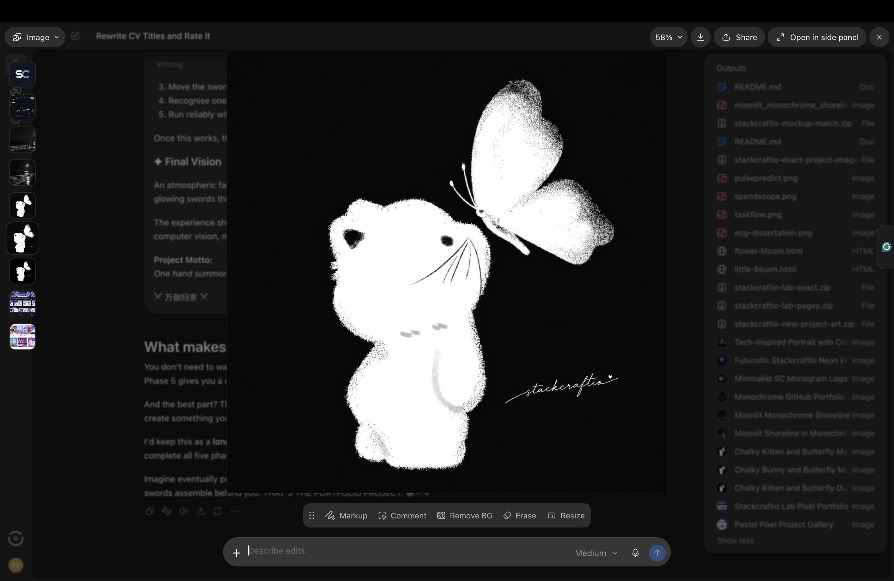

<h1 align="center">⚔️ Sword Sovereign </h1>

<em>Ten Thousand Swords Return to One</em>

<strong>One hand summons a sword. Two hands command ten thousand.</strong>

[**✧ 万剑归宗 ✧**](https://stackcraftio.github.io/Sword-Sovereign/)

A gesture-controlled 3D fantasy simulation inspired by xianxia and wuxia. Stand in front of your webcam and command thousands of glowing flying swords with your bare hands. It runs entirely in the browser, with no installs, no backend and no build step.

> This is a virtual visual simulation. It is not a physical drone or weapon-control system.

Built by **stackcraftio**.

---

## ✨ Features

- Real-time two-hand tracking with [MediaPipe Hands](https://developers.google.com/mediapipe/solutions/vision/hand_landmarker)
- Up to **10,000 swords** rendered with Three.js `InstancedMesh` (one draw call)
- 8 formations: orbit, wings, shield sphere, launch, precision, sword rain, spiral vortex and the giant-sword ultimate
- Glowing trails, bloom, energy particles, animated summoning circles, cinematic camera, optional sound
- 6 colour themes (including colour-shifting rainbow) and 5 environments
- Beginner and advanced control modes
- Mouse and keyboard fallback if you have no webcam

## 🖐️ Gestures

| Gesture | Ability | Key |
|---|---|---|
| No hand | Sword Orbit | `1` |
| ✋ Open palm | Sword Summoning | `2` |
| ✊ Closed fist | Defensive Formation | `3` |
| ☝️ Pointing finger | Sword Launch (swords fly to your fingertip) | `4` |
| 👌 Pinch | Precision Control (one big sword follows your fingertips) | `5` |
| ✌️ Peace sign | Rain of Swords | `6` |
| 🙌 Both palms open, close together | Spiral Vortex | `7` |
| 🙆 Both palms open, wide apart | Ten Thousand Swords (vortex, then one giant sword) | `8` |

Keys `1`–`8` also work while the camera is on and override hand control. Press `0` or `Esc` to give control back to your hands. You can also click the gesture cards on screen.

---

## 📄 License

[MIT](LICENSE) © 2026 stackcraftio

